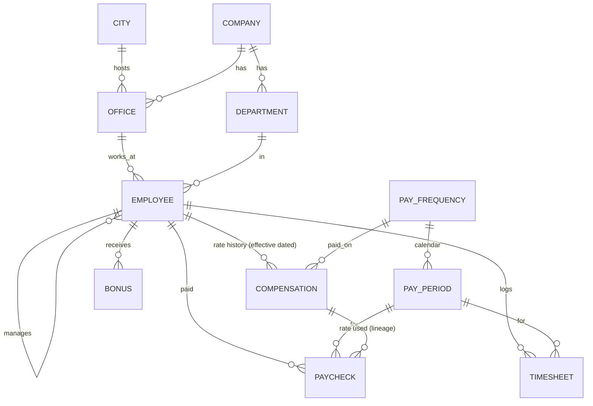
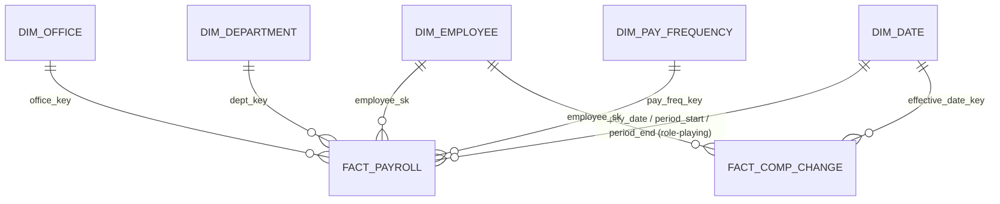

# DB Design Case Study: Multi-Company Payroll (OLTP → Star Schema → Reports)

A full interview-style design problem: model the data, load mock data, run payroll, build a data warehouse, and answer the reporting questions. Every file runs, so you can check each answer by eye.

> **Prompt (as an interviewer would say it):**
> "Companies have offices in several cities. Employees are paid a **monthly salary** or **by the hour**. Pay goes out **monthly, every 15 days (semi-monthly) or quarterly**. Design the database and the warehouse, and show me reports like *total salary by company, city and quarter* and *who got a raise compared with their previous pay*."

## Files (run in order)

| File | What it shows |
|---|---|
| `01_oltp_schema.sql` | Normalized source model: company, city, office, department, employee, **effective-dated compensation**, pay calendar, timesheet, bonus, paycheck |
| `02_mock_data.sql` | 2 companies, 3 cities, 4 offices, 13 employees, H1 2026 pay calendar, timesheets, bonuses. Each row exists to make a report or trap visible |
| `03_payroll_run.sql` | The payroll engine as one `INSERT … SELECT` using a **point-in-time join**. It produces 93 paychecks and the reporting view `v_paycheck` |
| `04_dw_star_schema.sql` | Kimball star schema: `dim_date`, `dim_office`, `dim_department`, `dim_pay_frequency`, `dim_employee` (**SCD2**), `fact_payroll`, `fact_comp_change`, `agg_payroll_monthly` |
| `05_etl_load_dw.sql` | ELT from OLTP to the warehouse: date dim generation, SCD2 initial load, surrogate-key lookup, unknown member, **idempotent** delete-window-then-insert |
| `06_reports_oltp.sql` | 17 reports: the **raise trap vs the correct raise report**, ROLLUP by company/city, pivot by frequency, QoQ, YTD, overtime, missing paychecks, top earner per city, earns more than manager |
| `07_reports_dw.sql` | Star-schema reports, point-in-time (as-of) salary, run-rate vs cash, **data-quality checks**, and an **SCD2 incremental load** inside `BEGIN … ROLLBACK` |

```bash
python db/run_with_duckdb.py dbdesign        # 00_setup runs too; table names don't clash
# PostgreSQL:
for f in db/dbdesign/0*.sql; do psql -d interview -f "$f"; done
```

---

## 1. Requirements → design decisions

| Requirement | Design decision | Why |
|---|---|---|
| A company has offices in many cities, and a city has many companies | `office(company_id, city_id)` resolves the M:N relationship | "Payroll by city" works across companies. Austin has both companies |
| Pay changes over time | `compensation` with `effective_from` / `effective_to` (NULL means current) | Rate history is SCD Type 2 at the source. Never overwrite salary on `employee` |
| Salary vs hourly | `pay_type` plus a CHECK: SALARY rows have `annual_salary`, HOURLY rows have `hourly_rate`, never both | Bad rows can't be stored |
| Monthly / 15-day / quarterly | `pay_frequency(freq_code, periods_per_year)` plus a `pay_period` calendar per frequency | Per-check pay = annual ÷ periods. Adding BIWEEKLY is just another row |
| Pay frequency can change | The frequency is stored on the **compensation** row, not on employee | Irene moves from monthly to semi-monthly on 2026-04-01 and is paid on the right calendar with no special code |
| Hourly pay needs hours | `timesheet(emp_id, period_id, regular, overtime)` | No approved timesheet means no paycheck, and the missing-paycheck report finds the gap |
| Paychecks are financial records | `paycheck` **snapshots** the rate, hours and amounts, and stores `comp_id` for lineage | Old pay is never recalculated from today's rate. This gives you an audit trail |
| Payroll can be re-run | `UNIQUE (emp_id, period_id)` | Idempotent: a re-run cannot pay anyone twice |
| Money | `NUMERIC(12,2)` | FLOAT rounding errors are unacceptable for pay |

### OLTP model



### Warehouse (star schema)



- **Grain:** `fact_payroll` has one row per paycheck (employee × pay period). Declare the grain first in an interview.
- **Additive measures:** hours, base, overtime, bonus, gross, tax, net. **Non-additive:** `annualized_rate`. Never SUM it.
- **dim_employee is a hybrid.** Title, pay type, frequency and rate are Type 2 (a change adds a new row). Company, city and department are Type 1 here (overwritten).
- **Surrogate key plus durable key.** `employee_sk` identifies the version. `emp_id` stays on the fact so you can get a person's full history without a dimension join.
- **Unknown member (`-1`).** Late-arriving dimension rows don't drop facts. `07 Q10` counts them.
- **Three fact types:** transaction (`fact_payroll`), change event (`fact_comp_change`), and aggregate (`agg_payroll_monthly`) for dashboards.

---

## 2. Mock data cheat sheet (who demonstrates what)

| Employee | Basis | What happens in H1 2026 | Shows |
|---|---|---|---|
| Alice | Monthly salary | 120k → 132k on Apr 1 (MERIT) | A plain raise |
| Bob | Monthly salary | No change, **5,000 bonus** in March | Gross went up, but it is **not a raise** |
| Carol | Semi-monthly salary | 72k → 84k on Mar 1 (PROMOTION) | A raise on the 15-day calendar |
| Dan | Hourly, semi-monthly | 25.00 → 27.50 on May 1, overtime most periods | **His first check after the raise is smaller** (fewer hours) |
| Eva | Hourly | No rate change. **No timesheet for Feb 16–28** | Gross noise; missing paycheck |
| Frank | Quarterly salary | 80k → 88k on Apr 1. **Earns more than his manager Carol** | Raise seen only at quarter end; self-join |
| Grace | Monthly salary | **New hire** Mar 1 | LAG is NULL, so this is not a raise |
| Irene | Monthly → **semi-monthly** | 110k → 115k on Apr 1 | **The check halves (9,166 → 4,791) even though it's a raise** |
| Jack | Hourly → **salary** | 20/h (= 41,600/yr) → 52k monthly | Conversion: compare `rate × 2080` with the salary |
| Kate | Monthly salary | 98k → 90k on May 1 (DEMOTION) | Pay cut |
| Leo | Hourly | **Terminated** Apr 30 | No paychecks after termination; headcount drops |
| Henry, Mia | Monthly / quarterly | No change | Controls |

---

## 3. The headline question: "Who got a raise from the previous pay?"

**Naive answer (wrong):** `gross_pay > LAG(gross_pay)`. `06 Q1` shows that it flags Bob (bonus), Eva and Leo (hours), and Dan 6 times. It also **misses Irene**, whose check halved after her raise.

**Correct answer (`06 Q2`):** compare the **annualized base rate** of each paycheck with the previous paycheck:

```sql
annualized_rate = CASE pay_type WHEN 'SALARY' THEN annual_salary ELSE hourly_rate * 2080 END

LAG(annualized_rate) OVER (PARTITION BY emp_id ORDER BY pay_date) AS prev_rate
... WHERE annualized_rate > prev_rate
```

Result: Carol, Irene, Alice, Jack, Dan and Frank got raises, and Kate got a cut (`06 Q3`).

Follow-ups interviewers ask:
- *"What is the source of truth?"* The `compensation` history (`06 Q4`). A paycheck-based report only sees a change once it has been **paid**. Frank's April raise first appears on the June 30 quarterly check.
- *"In the warehouse?"* Precompute it once in ETL as `fact_comp_change`. The report then becomes a simple filter (`07 Q1`).
- *"Raise % across bases?"* Normalize everything to annual (or monthly-equivalent) values (`06 Q15`).

---

## 4. ETL / data-engineering design (how this runs at scale)

```
HRIS / Payroll DB ──CDC (Debezium / DMS)──▶ Bronze (raw, append-only, partitioned by ingest_date)
                                               │  dedupe, cast types, mask PII
                                               ▼
                                          Silver (clean entities, compensation SCD2, paycheck)
                                               │  SK lookups, conformed dims
                                               ▼
                                          Gold (dim_*, fact_payroll, fact_comp_change, agg_*)
                                               │
                                               ▼
                                          BI / ad-hoc SQL / HR dashboards
```

| Topic | Answer to give |
|---|---|
| **Load order** | Load dimensions first, then facts. Facts look up surrogate keys **as of** `period_end` |
| **Idempotency** | Overwrite the partition or window (`DELETE` window + `INSERT`, Spark `insertInto(..., overwrite)` with dynamic partition overwrite, or Delta `MERGE`). A re-run gives the same result |
| **Incremental** | Use CDC or a watermark (`updated_at > last_run`). New comp versions → SCD2 expire + insert (`07 Q11`) |
| **Late-arriving facts** | Retro pay or back-dated raises: re-open affected partitions (pay months), or post an **adjustment** fact row. Never edit paid history |
| **Late-arriving dimensions** | The fact gets `employee_sk = -1` (or an inferred member). A later run repairs it. Monitor the count |
| **Partitioning** | `fact_payroll` by `pay_year/pay_month` (from `pay_date_key`). Query filters prune partitions |
| **Join strategy** | Dims are small, so broadcast them. The fact is large. Bucket or Z-order by `emp_id` for per-employee history |
| **Skew** | Pay dates cluster on the 15th, month end and quarter end. Salt or use AQE skew-join handling for those partitions |
| **Data quality** | Every run: source vs DW totals reconcile, grain uniqueness, no SCD2 overlaps or gaps, one current row per employee, unknown-member count (`07 Q7–Q10`). Tools: Great Expectations, Deequ, dbt tests |
| **Orchestration** | Airflow / Dagster on the **pay calendar** (15th, EOM, quarter end) plus a daily CDC sync. The DQ gate blocks publishing |
| **Security** | Salary is sensitive PII. Use column-level encryption or masking, row-level security (managers see only their org), and audit logging |
| **Rounding** | 95,000 ÷ 12 = 7,916.67 × 12 = 95,000.04. Real payroll trues up the last period of the year. Mention it |
| **Proration** | Mid-period hires and changes are prorated by working days. Out of scope here, but say it |
| **Cash vs accrual** | Monthly cash spikes in quarter-end months because of quarterly payees. Finance often wants accrual or run-rate (`07 Q5`) |

### The same raise report in Spark (PySpark)

```python
from pyspark.sql import functions as F, Window as W

w = W.partitionBy("emp_id").orderBy("pay_date")
pay = (spark.table("silver.paycheck")
       .withColumn("annualized_rate",
                   F.when(F.col("pay_type") == "SALARY", F.col("annual_salary"))
                    .otherwise(F.col("hourly_rate") * 2080))
       .withColumn("prev_rate", F.lag("annualized_rate").over(w))
       .withColumn("prev_pay_date", F.lag("pay_date").over(w)))

raises = (pay.filter(F.col("annualized_rate") > F.col("prev_rate"))
             .withColumn("raise_pct", F.round((F.col("annualized_rate") / F.col("prev_rate") - 1) * 100, 2)))
```

### SCD2 with Delta Lake MERGE (one statement instead of `07 Q11`'s steps)

```sql
MERGE INTO gold.dim_employee AS d
USING (
    -- every changed row twice: once to EXPIRE (merge_key = emp_id), once to INSERT (merge_key = NULL)
    SELECT s.emp_id AS merge_key, s.* FROM stg_comp_changes s
    UNION ALL
    SELECT NULL AS merge_key, s.* FROM stg_comp_changes s
) AS src
ON d.emp_id = src.merge_key AND d.is_current
WHEN MATCHED AND d.annualized_comp <> src.annualized_comp THEN
    UPDATE SET d.is_current = false, d.effective_to = date_sub(src.effective_from, 1)
WHEN NOT MATCHED THEN
    INSERT (emp_id, job_title, annualized_comp, effective_from, effective_to, is_current)
    VALUES (src.emp_id, src.job_title, src.annualized_comp, src.effective_from, DATE'9999-12-31', true);
```

*(Use `xxhash64` / an identity column for the surrogate key in Spark. `ROW_NUMBER() + MAX(sk)` is fine for a single-writer batch.)*

---

## 5. Interview Q&A on this design

1. **Why not keep `salary` on the employee table?** You lose history. Raise reports, point-in-time pay and audits all need effective-dated rows.
2. **SCD Type 1 vs 2 vs 3?** Type 1 overwrites. Type 2 adds a row with effective dates and a current flag. Type 3 keeps a "previous value" column (one level of history only). Type 6 = 1 + 2 + 3.
3. **Why surrogate keys?** SCD2 needs several rows per natural key. They also insulate the warehouse from source key changes and make joins on integers fast.
4. **What is the grain of `fact_payroll`?** One paycheck, i.e. employee × pay period. Everything else follows from that.
5. **Which measures are non-additive?** Rates (`annualized_rate`) and percentages. Average them or recompute them; never SUM them.
6. **How do you compare monthly, semi-monthly, quarterly and hourly employees?** Annualize: salary as is, hourly × 2080, per-check × periods per year.
7. **Why might a raise not show up in a paycheck-based report?** The change isn't paid yet (quarterly payee, future-dated). Use the compensation history as the source of truth.
8. **How do you find employees who weren't paid?** Build the *expected* set (employed × their calendar) and anti-join it to actual paychecks (`06 Q13`).
9. **How do you make the ETL re-runnable?** Delete or overwrite the target window or partition, then insert. Or MERGE on the grain key, plus a unique constraint on the grain.
10. **What is a point-in-time join?** `src.date BETWEEN dim.effective_from AND dim.effective_to`. Use `9999-12-31` instead of NULL for open rows so BETWEEN stays simple.
11. **Normalized OLTP vs star schema?** OLTP is 3NF for write integrity. A star is denormalized for read speed and simple joins. Snowflaking dims saves space but adds joins.
12. **Why no FKs in the warehouse?** Bulk-load speed and late data. Integrity is enforced by ETL and DQ checks instead.
13. **How would you handle a retroactive raise?** Insert the comp version with a back-dated `effective_from`, compute the delta for already-paid periods, and pay it as an adjustment line on the next check. Leave history unchanged.
14. **How would you scale to 10M employees × 24 periods/year?** About 240M fact rows a year. Partition by pay month, broadcast the dims, use columnar storage (Parquet/Delta), keep aggregates for dashboards, and Z-order by `emp_id`.
15. **How do you protect salary data?** Column masking, row-level security, encryption at rest and in transit, least-privilege roles, and audit logs. Don't put PII in bronze without masking.
